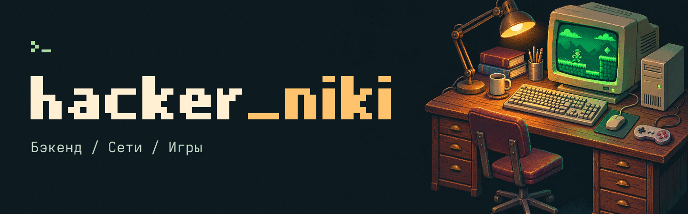

<picture>
  <source media="(prefers-reduced-motion: reduce)" srcset="https://raw.githubusercontent.com/hacker-niki/hacker-niki/main/assets/hacker_niki.webp">
  
</picture>

## Привет, я Никита

Бэкенд-разработчик, **3+ года опыта**. Мой стек — **Go (Golang), PHP, C++ и Python**. Здесь же выкладываю игры и настольные приложения.

[Портфолио](https://hacker-niki.github.io/#about) · [Демотека](https://hacker-niki.github.io/demos/) · [Telegram @hacker_niki](https://t.me/hacker_niki)

## Два проекта в браузере

  
  

**[THEGame](https://github.com/hacker-niki/THEGame)** · музыкальный раннер 
Уводи куб от препятствий в такт музыке. В игру можно загрузить свой трек и построить по нему трассу. [Запустить игру](https://hacker-niki.github.io/THEGame/play/)

**[docsManager](https://github.com/hacker-niki/docsManager)** · C++ и Qt 
Заполни поля в шаблоне письма и скачай готовый документ Word. Можно загрузить свой шаблон DOCX. [Собрать документ](https://hacker-niki.github.io/demos/lab/docsmanager.html)

Ещё на GitHub · [HoldBeat](https://github.com/hacker-niki/HoldBeat) — таймер тренировок · [kTone](https://github.com/hacker-niki/kTone) — мой Android-порт тюнера · [Box Analyzer](https://github.com/hacker-niki/box-analize) — компьютерное зрение для коробок, **в разработке**.
