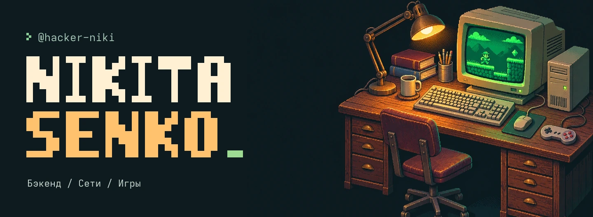

Привет, я Никита. Пишу бэкенд на **Go и PHP**. Ещё у меня есть свой `traceroute` на C++ и раннер на Unity, в котором герой сам бежит вперёд. От игрока зависит, как далеко он доберётся.

## Что попробовать

| Проект | Что внутри |
| :--- | :--- |
| [Org API](https://github.com/hacker-niki/go-test) | Дерево подразделений на Go и PostgreSQL. Можно запросить отдел вместе с сотрудниками или целиком перенести его в другую ветку. |
| [traceroute](https://github.com/hacker-niki/traceroute) | Консольная утилита на C++. Для каждого узла на пути к IPv4-адресу показывает имя и время ответа. |
| [THEGame](https://github.com/hacker-niki/THEGame) | Пять уровней на Unity и C#. Управление двумя клавишами — обходи препятствия и держись на платформе. |
| [docsManager](https://github.com/hacker-niki/docsManager) | Настольный генератор документов на C++ и Qt. Выбираешь шаблон DOCX, заполняешь поля и получаешь готовый документ. |
| [API покупки](https://github.com/hacker-niki/Symfony-backend-test) | Бэкенд на Symfony. Применяет купон, считает налог по стране покупателя и проводит тестовую оплату. |

[Все публичные репозитории →](https://github.com/hacker-niki?tab=repositories)
